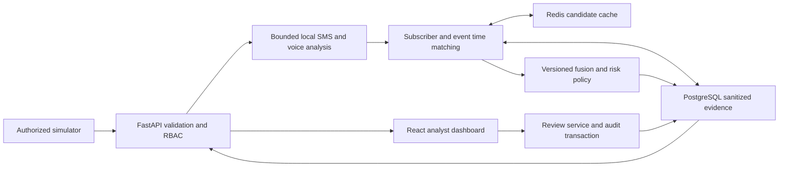

# KAVACH Architecture

## Phase A/B implementation refinement

The user's current authorization selects Python 3.12 and FastAPI for the backend foundation only. The Python package uses a `backend/src/kavach/` layout; conceptual `backend/api/` and `backend/core/` paths below map to `backend/src/kavach/api/` and `backend/src/kavach/core/`. Future domain modules will follow the same mapping when needed. Backend tests remain in `backend/tests/`; root `tests/` is reserved for cross-application tests.

The application factory is `kavach.main:create_app`. Current public health aliases report process liveness and `analysis_ready: false`, with no dependency details. Settings currently consume only `APP_ENV` and `LOG_LEVEL`; dotenv loading is explicit. No database, authentication, models, Redis, Compose or frontend are initialized in this phase. This user-directed milestone is narrower than the full architecture below. Exact direct dependencies and Python are pinned and the installed environment passes the test suite (31 October 2026 audit); transitive lock generation (`backend/uv.lock`) is still outstanding technical debt.

## Status and scope

Proposed architecture under PRD decisions D01–D10. Follow [PRD.md](PRD.md) and [DESIGN.md](DESIGN.md); database and HTTP contracts live in [DATABASE.md](DATABASE.md) and [API.md](API.md). This document specifies a future implementation, not an existing system. The source handbook supports Python/FastAPI, React, Redis, scikit-learn, Librosa, Whisper-tiny and Compose; the additional choices below are recommendations.

## Technology choices

| Layer | Choice | Reason |
| --- | --- | --- |
| Frontend | React, TypeScript, Vite, React Router | Small client-rendered analyst application; no SEO/server rendering need |
| UI | CSS variables and reusable React components | Implements DESIGN.md without a large visual framework |
| Backend | Python, FastAPI, Pydantic, Uvicorn | Typed request contracts and local Python inference |
| Durable data | PostgreSQL, SQLAlchemy, Alembic, psycopg | Transactions, constraints, migrations and durable review history |
| Temporary state | Redis | Expiring candidate cache and shared rate counters |
| SMS/fusion | scikit-learn | Reproducible TF-IDF logistic baseline and logistic fusion |
| Voice | Librosa, local Whisper-tiny, versioned classical classifiers | Separate acoustic and semantic inference without hosted transmission |
| Authentication | Argon2id library, opaque database-backed sessions | Small provisioned-user deployment; no custom password cryptography |
| Local deployment | Docker Compose with reverse proxy | Reproducible frontend/API/database/cache setup |
| Tests | pytest, Vitest/Testing Library, Playwright | Domain/integration, component, and critical browser tests |

Pin mutually compatible supported versions and lockfiles at setup; this specification does not assert unverified package versions. Do not install every optional ML dependency before confirming D04 and target hardware. Vite supports React/TypeScript templates; type checking must be a separate build gate. [Vite guide](https://vite.dev/guide/)

## Runtime boundaries

Use one backend deployment, one API process, a bounded inference executor, PostgreSQL and Redis. The frontend is static assets served with `/api` and WebSocket requests proxied to FastAPI on the same origin. No microservices, message broker, distributed task framework, vector database or hosted LLM is required.

Ingestion is synchronous and bounded for the controlled MVP: an accepted request returns only after its sanitized result is durably committed. There is no `202 Accepted` job queue or promise of crash-proof raw-payload processing. If the process crashes before commit, the client retries the same event ID; after commit the same ID returns the existing receipt. A bounded, killable inference worker must enforce the total deadline; an HTTP timeout alone does not cancel computation. Start with one model-owning worker and at most two admitted analyses, including queued admission. Busy requests are rejected rather than accumulated indefinitely.

Model memory is multiplied by worker processes; measure memory before adding workers. [FastAPI deployment concepts](https://fastapi.tiangolo.com/deployment/concepts/)

## Data flow

1. Authenticate; rate-limit; validate event schema and allowlisted sample identity. HMAC canonical payload for retry comparison; never log the payload.
2. Check unique `(source, external_event_id)` and payload fingerprint. Existing same payload returns the original result; changed payload conflicts.
3. Analyze raw text/audio in memory. Decode audio within byte/duration limits. Convert results to allowlisted structured features; discard raw text/transcript and intermediates after processing.
4. Begin a transaction. Serialize same-subscriber writes using a PostgreSQL transaction advisory lock derived from the subscriber digest. Recheck idempotency. Insert the sanitized event and its standalone incident/assessment.
5. Query opposite-channel events in the approved event-time window. Redis may accelerate lookup, but a database candidate query inside the lock is authoritative and prevents missed concurrent pairs. Validate context and eligibility; create unique pair incidents and assessments.
6. Commit event, incidents, assessments and required audit records together. Cache sanitized candidate IDs after commit; cache failure cannot roll back the durable result.
7. Return the receipt and notify subscribed clients with incident IDs/revisions only. Clients refetch authorized REST resources. A missed notification is recovered by polling/reconnect.

Do not hold database locks while decoding or running models. Concurrent duplicate requests can do redundant inference but only one durable result may commit. Retry a transaction only for safe transient database conflicts with a small bound; never blindly repeat a completed external side effect.

## Correlation and score policy

Proposed D05 algorithm: same pseudonymous subscriber; absolute event-time difference ≤30 minutes; sufficient structured context beyond shared brand alone. A later-arriving event is eligible for correlation when its own arrival lateness is ≤10 minutes. Late events still receive standalone analysis and a `late_event` explanation but do not initiate new pairs. Test both arrival orders and exact boundaries. These limits apply relative to server UTC; simulator scenarios use fresh timestamps.

Retain sanitized cache candidates for window plus lateness (40 minutes). Always recheck event time; cache TTL is not a semantic match rule. Cache misses fall back to retained database events. Redis expiration supports temporary state but does not define event-time correctness. [Redis EXPIRE](https://redis.io/docs/latest/commands/expire/)

Fusion inputs include continuous SMS and voice-intent scores, entity/context match and time delta in explicitly documented units. Synthesis is displayed separately; adding it to fusion requires evaluated model-manifest support. No arbitrary learned coefficients may be invented. Missing required fusion inputs means fusion unavailable, not zero-filled normality. Preserve base risk according to PRD; document the final maximum policy as uncalibrated unless separately validated. Persist feature schema, model/policy versions and reason codes. Deterministic structured explanations are sufficient; no generative AI explanation service.

Incident assessments are append-only revisions. MVP creates initial assessments on event/pair creation; no automatic reprocessing on model deployment. Any later reprocessing feature needs an approved task, an append-only revision, and a new evaluation report. Expiry never rewrites a historical assessment or reduces a standalone score.

## Model lifecycle

Keep training offline under `experiments/`; runtime only loads trusted, checksummed artifacts from an operator-controlled directory. Never deserialize user-uploaded pickle/joblib files. Record artifact digest, dataset/split version, preprocessing, feature order/units, coefficients, calibration method, thresholds, license, supported languages and measured limitations in each manifest. Distinguish SMS logistic classification from logistic fusion.

Use three-second audio chunks with a proposed one-second stride, aggregating chunk results through a documented, evaluated rule. This stride/aggregation is a D04 implementation proposal, not a verified V4 detail. Report audio collection time separately from model time. Acoustic classifier training and voice-intent model selection require actual datasets; if artifacts are missing, report unavailable rather than install a fake predictor. Test doubles stay test-only.

CPU is acceptable for a local demo with measured latency. GPU overload may skip STT only with explicit `stt_unavailable` and degraded classification; never silently use synthesis as a substitute for intent. No unverified 95% GPU policy is hardcoded as a production guarantee.

## Authentication and authorization

D03 proposes operator-provisioned accounts; no public signup or password-reset email system. Hash passwords with maintained Argon2id tooling. Store only digests of cryptographically random session tokens and API keys. Browser session cookie: HttpOnly, Secure in shared environments, SameSite=Lax, host-only, path `/`. Proposed idle expiry 30 minutes, absolute expiry 8 hours. Rotation on login; revocation on logout, account disable or password reset.

Use session-bound CSRF tokens and Origin checks for state-changing browser requests, including login Origin validation. Never store bearer/session credentials in localStorage. Ingestors use scoped API keys in Authorization headers, never URL query strings. Check current active state and role server-side on every operation. WebSockets require a valid cookie session and allowed Origin; revalidate at least every minute and close on expiry/revocation.

All evidence belongs to one deployment organization. This is not multi-tenant isolation. See DATABASE.md for database privileges; any future multi-organization design requires schema, authorization and migration changes together.

## Folder structure

| Path | Responsibility |
| --- | --- |
| `frontend/src/app/` | Routing, app shell, session state |
| `frontend/src/components/` | Shared accessible UI |
| `frontend/src/features/` | incidents, reviews, simulator, system, auth |
| `frontend/src/lib/` | Typed API transport, dates, errors |
| `frontend/src/styles/` | Tokens and global styles |
| `backend/api/` | Routes, dependencies, DTOs; no model training |
| `backend/services/` | Ingestion, incident and review orchestration |
| `backend/models/` | Inference adapters and artifact manifests, not ORM tables |
| `backend/correlation/` | Matching and continuous fusion |
| `backend/policy/` | Tier policy and reason codes |
| `backend/privacy/` | Sanitization, keyed digests, audit signing |
| `backend/auth/` | Sessions, API keys, role checks |
| `backend/db/` | SQLAlchemy entities, repositories and migrations |
| `backend/core/` | Config, clock, logging, safe errors |
| `backend/tests/` | Unit and integration tests |
| `experiments/` | Dataset manifests, training and evaluation procedures |
| `data_schemas/` | Shared evidence schema documentation |
| `deployment/` | Compose, reverse proxy and operation scripts |
| `tests/e2e/` | Browser journeys |

## Environment configuration

Use validated server settings with fail-fast required secrets. Document names in `.env.example`, values only in ignored local files or deployment secret storage. API.md is the canonical variable inventory. Browser builds receive only same-origin public routing configuration, never database URLs, signing keys, session secrets or model paths. Separate development, test and pilot databases, keys, fixtures and model manifests.

## Failure and security boundaries

- API boundary rejects unknown fields, invalid/oversized timestamps and payloads, unauthorized identities and arbitrary sample references.
- Model boundary treats input as untrusted data. No executing text instructions, arbitrary file loading, outbound URL fetching, or shell interpolation.
- Persistence boundary allowlists structured output and uses parameterized queries. Redaction alone is insufficient.
- External error responses expose a safe code/request ID; internal logs exclude raw content, credentials, subscriber digests and transcript-derived free text.
- Database outage: fail writes with 503 and no successful receipt. Redis outage: durable correlation fallback; password login fails closed with 503 (shared throttle state cannot be validated; no in-process fallback, C-06); other writes fail closed if limits cannot be enforced; any conservative in-process limit for reads is an M3 decision.
- Model failure: persist explicit partial/unavailable stage results if metadata processing succeeds; system status indicates loss of capability.
- Audit write/sign failure on an audited mutation: roll back mutation. HMAC protects detectable modification, not removal of records by a privileged database operator.

## Testing and deployment

Use real PostgreSQL/Redis in integration tests; test mocks only at explicit model/provider boundaries. Cover candidate concurrency, deduplication, transaction rollback, RBAC, session/CSRF behavior, privacy leakage, stale reviews and restore. Evaluation datasets are distinct from UI demo fixtures.

Local Compose services: static UI/reverse proxy, backend, PostgreSQL and Redis; model assets are read-only mounted. Database/cache ports stay private. Persistent PostgreSQL volume; Redis candidate persistence disabled. Run migrations once before starting traffic. Health distinguishes public liveness from authenticated dependency readiness. Missing models may permit diagnostic UI but must fail full analysis readiness.

Pilot deployment requires D10, TLS, restricted networking, encryption/backup controls, measured capacity and documented operator authority. Do not select AWS g5.xlarge solely because it appears in historical benchmark claims. Future asynchronous workers, durable encrypted raw jobs, OIDC, multi-tenancy and carrier streaming require new requirements and capacity evidence; they are not hidden MVP dependencies.
