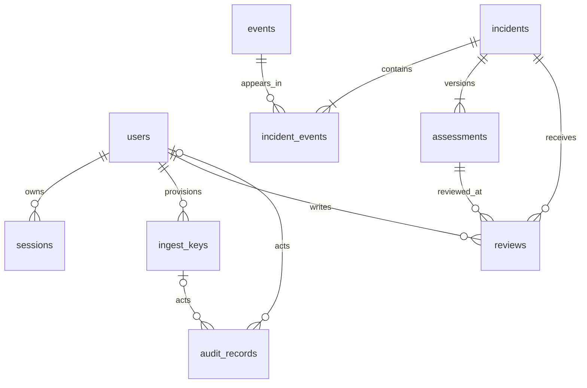

# KAVACH Database Specification

## Status and conventions

Proposed under PRD D02, D03, D05 and D07. Use PostgreSQL for durable state and Redis only for temporary cache/rate counters. No schema has been created. [ARCHITECTURE.md](ARCHITECTURE.md) defines transaction flow; [API.md](API.md) defines exposure.

All durable IDs are UUIDs unless stated otherwise. All timestamps are UTC `timestamptz`. Fields are required unless marked nullable. Server-generated `created_at` defaults to the database current time. Scores use `double precision` with finite range checks 0–1; nonfinite values are forbidden. Enum-like fields use text plus CHECK constraints so additions are explicit migrations. JSONB has an application schema and a bounded size; it is not an unrestricted payload archive.

## Tables and columns

### users

| Column | Type | Constraints |
| --- | --- | --- |
| id | uuid | Primary key |
| username | varchar(80) | Unique canonical lowercase username |
| display_name | varchar(120) | Required; not an authorization key |
| password_hash | text | Argon2id encoded hash; never returned |
| role | text | viewer, analyst, admin |
| is_active | boolean | Default true |
| created_at | timestamptz | Server assigned |
| updated_at | timestamptz | Server updated |

No email/phone is required. Provision and disable users with audited operator commands. Deactivate rather than delete users referenced by reviews/audit.

### sessions

| Column | Type | Constraints |
| --- | --- | --- |
| id | uuid | Primary key |
| user_id | uuid | FK users, ON DELETE CASCADE |
| token_digest | bytea | Unique 32-byte digest of high-entropy token |
| csrf_digest | bytea | 32-byte digest of session-bound CSRF token |
| created_at | timestamptz | Required |
| last_seen_at | timestamptz | Required |
| expires_at | timestamptz | Absolute deadline after creation |
| revoked_at | timestamptz | Nullable |

Idle timeout is evaluated from `last_seen_at`; absolute timeout from `expires_at`. Do not persist browser fingerprint, raw IP or user agent by default.

### ingest_keys

| Column | Type | Constraints |
| --- | --- | --- |
| id | uuid | Primary key |
| name | varchar(80) | Operator-readable identifier |
| key_digest | bytea | Unique 32-byte digest; plaintext shown only on provisioning |
| source | varchar(64) | Approved source scope |
| created_by | uuid | FK users, RESTRICT |
| created_at | timestamptz | Required |
| expires_at | timestamptz | Required |
| revoked_at | timestamptz | Nullable |

One capability: submit events and read receipts for its own source. Do not add arbitrary JSON permission grants.

### events

| Column | Type | Constraints |
| --- | --- | --- |
| id | uuid | Primary key |
| source | varchar(64) | Matches authenticated scope; admin simulator source is `simulator` |
| external_event_id | varchar(128) | Unique together with source |
| kind | text | sms or call |
| subscriber_digest | bytea | 32-byte keyed digest, never raw subscriber token |
| identity_key_version | varchar(32) | Version needed for digest lookup and rotation |
| payload_digest | bytea | 32-byte HMAC over canonical validated request for idempotency |
| payload_key_version | varchar(32) | HMAC key version |
| event_time | timestamptz | Client event time, validated |
| received_at | timestamptz | Server arrival time |
| analysis_status | text | complete, partial, unavailable |
| sms_score | double precision | Nullable; only for sms |
| voice_intent_score | double precision | Nullable; only for call |
| synthesis_score | double precision | Nullable; only for call |
| signals | jsonb | Allowlisted structure described below |
| model_versions | jsonb | Map stage name to immutable artifact/version ID |
| processing_ms | integer | ≥0 |
| expires_at | timestamptz | Required; retention deadline |

`signals` contains reason-code arrays, approved canonical organization labels, intent category, boolean URL-risk indicators, context confidence where supported, per-stage status/duration, audio duration/sample ID for synthetic fixtures, and late-event status. Never store arbitrary entity text, URLs, phone numbers, OTPs, raw sender IDs, SMS, transcript, audio or feature vectors. Missing-score reason is required for every unavailable stage. Cap serialized signals at 16 KiB and versions at 4 KiB.

Store only post-analysis events; a pending raw job table is intentionally absent. `kind` consistency CHECKs prohibit voice scores on SMS and SMS scores on calls. Stronger status/signal-schema validation is enforced at the service boundary.

### incidents

| Column | Type | Constraints |
| --- | --- | --- |
| id | uuid | Primary key |
| kind | text | standalone or pair |
| incident_key | varchar(160) | Unique canonical key: one event UUID or ordered SMS/call UUIDs |
| occurred_at | timestamptz | Latest constituent event time, immutable |
| current_revision | integer | ≥1; matches latest assessment |
| latest_review_id | uuid | Nullable FK reviews; same-incident requirement |
| version | integer | ≥1; increment on review/assessment change |
| created_at | timestamptz | Required |
| updated_at | timestamptz | Required |
| expires_at | timestamptz | Minimum expiry of constituent events |

### incident_events

| Column | Type | Constraints |
| --- | --- | --- |
| incident_id | uuid | FK incidents, CASCADE; part of primary key |
| event_id | uuid | FK events, RESTRICT; part of primary key |
| channel | text | sms or call; must match event kind |

Unique `(incident_id, channel)` permits at most one event of each channel. Standalone requires exactly one event; pair requires exactly one SMS and one call. Enforce cardinality, matching channel and same subscriber/key version using a deferred database constraint trigger plus service validation. Do not merge different subscribers through a client-provided incident ID.

### assessments

| Column | Type | Constraints |
| --- | --- | --- |
| incident_id | uuid | FK incidents, CASCADE; composite primary key |
| revision | integer | ≥1; composite primary key |
| base_score | double precision | Nullable |
| fusion_score | double precision | Nullable; only pairs |
| final_score | double precision | Nullable |
| tier | text | unknown, low, medium, high, critical |
| analysis_status | text | complete, partial, unavailable |
| evidence | jsonb | Bounded structured snapshot: signal scores/statuses, event IDs, time delta, subscriber/context checks, reasons |
| model_versions | jsonb | Exact artifacts used |
| policy_version | varchar(80) | Immutable policy identifier |
| created_at | timestamptz | Required |

`unknown` requires null final score; a known tier requires a finite final score. Policy thresholds and score-floor equality are validated by the domain service and tests against `policy_version`. Cap evidence at 32 KiB. No raw content. Enforce `(incidents.id, current_revision)` → `(assessments.incident_id, revision)` with a deferred FK so initial incident and assessment can be inserted atomically.

### reviews

| Column | Type | Constraints |
| --- | --- | --- |
| id | uuid | Primary key |
| incident_id | uuid | FK incidents, CASCADE |
| assessment_revision | integer | Composite FK with incident_id to assessments |
| analyst_id | uuid | FK users, RESTRICT |
| decision | text | true_fraud, false_alarm, needs_investigation |
| note | varchar(1000) | Nullable; sanitized; no raw communications |
| idempotency_key | uuid | Unique together with analyst_id |
| payload_digest | bytea | 32-byte digest for conflict detection |
| created_at | timestamptz | Server assigned |

Reviews are append-only; corrections are new reviews. Add unique `(incident_id, id)` and use composite FK `(incidents.id, latest_review_id)` to ensure the latest review belongs to that incident. This nullable deferred FK is checked within the same transaction as review insertion. Review history retains the exact assessment revision viewed.

### audit_records

| Column | Type | Constraints |
| --- | --- | --- |
| id | uuid | Primary key |
| actor_user_id | uuid | Nullable FK users, RESTRICT |
| actor_ingest_key_id | uuid | Nullable FK ingest_keys, RESTRICT |
| actor_kind | text | user, ingestor, system |
| action | varchar(80) | Allowlisted action code |
| resource_type | varchar(40) | Allowlisted type |
| resource_id | uuid | Nullable; intentionally not FK to expiring evidence |
| request_id | uuid | Correlation ID, never request content |
| outcome | text | success or denied |
| created_at | timestamptz | Required |
| key_version | varchar(32) | Signing key identifier |
| record_hmac | bytea | 32-byte HMAC over canonical stored fields except signature |
| expires_at | timestamptz | Required |

Actor CHECKs require matching non-null actor FK for user/ingestor and neither for system. No raw text, IP, subscriber digest, review note or credential in audit records. The application has INSERT/SELECT only on audit records; the retention role alone deletes expired records. HMAC detects alteration when checked with protected keys; it does not establish append-only external storage or prove that records were not deleted. Independently controlled backups are needed for stronger assurance.

## Relationships

## Queries and indexes

| Query | Index |
| --- | --- |
| Login lookup | Unique users(username) |
| Session/key validation | Unique token_digest / key_digest |
| Idempotent event receipt | Unique events(source, external_event_id) |
| Candidate opposite-channel events | events(subscriber_digest, identity_key_version, kind, event_time, id) |
| Feed ordered by occurred_at/id | incidents(occurred_at DESC, id DESC) |
| Incident kind filter | incidents(kind, occurred_at DESC, id DESC) |
| Assessment revision lookup | Primary key assessments(incident_id, revision) |
| Evidence reverse links | incident_events(event_id, incident_id) |
| Review history | reviews(incident_id, created_at, id) |
| Review retry | Unique reviews(analyst_id, idempotency_key) |
| Expiry cleanup | events(expires_at), incidents(expires_at), sessions(expires_at), audit_records(expires_at) |

Tier/status filters join the current assessment/latest review. Inspect actual query plans before adding indexes for these filters; at the MVP data size do not denormalize scores into multiple tables merely for speculative speed. Do not index unqueried JSONB indiscriminately.

## Ownership and database privileges

Single organization per deployment. Only backend/operator jobs connect to PostgreSQL; browsers never do. Every route enforces role permissions. Ingestors see only event receipts scoped by their key source. Dashboard users see the single organization's evidence; user/session/key administration is operator-only.

Use distinct migration-owner, runtime and retention roles. Runtime has no schema DDL, user-role bypass, review/assessment UPDATE/DELETE, or audit UPDATE/DELETE. Retention uses narrowly scoped expiry procedures. Table grants and service authorization are the proposed MVP boundary. Row-level security is not required for one deployment scope and no direct client database access; if tenant ownership is introduced, add tenant keys and default-deny policies before enabling tenant traffic. PostgreSQL RLS policy behavior and owner bypass must be explicitly tested in that change. [PostgreSQL row security](https://www.postgresql.org/docs/17/ddl-rowsecurity.html)

## Redis keys

Candidate key `candidate:{identity_key_version}:{subscriber_digest}` stores only event IDs, kinds and event times with TTL 40 minutes, refreshed on write. Candidate validation always uses event time and durable records. Login/read/ingest counters have policy-defined TTLs. Never store raw text/audio/transcripts or secrets in Redis. Disable persistence for candidate state; separate namespaces for test/development. Loss of cache does not lose reviews or authoritative idempotency.

## Retention, migration and recovery

Proposed D07 retention: events and linked incidents/assessments/reviews expire after seven days; audit records after 30 days; expired/revoked sessions are removed promptly. A daily job first deletes expired incidents and their cascading links/assessments/reviews, then unreferenced expired events, then expired audits/sessions. Circular deferred FKs must be tested in cleanup transactions. Remove cache references opportunistically; stale IDs are ignored. Logs use bounded retention and exclude communications. Account/key records are retained while audit/history references exist; deactivation/revocation is immediate.

Backups have a documented finite retention; expired sensitive records may remain only until backup expiry. Restoring a backup must run retention cleanup before exposing service. Do not claim immediate erasure from historical backups.

Use reviewed Alembic migrations with a fresh-database path and an upgrade path. Test constraints and rollback on a disposable database. Prefer forward repair for deployed data; never drop data automatically to fix a failed migration. Seed synthetic users/events only via explicit development commands with operator-supplied passwords, not embedded defaults. Keep evaluation corpora out of production seeds.

Before a pilot: encrypted daily backups, isolated access, key recovery procedures, proposed RPO 24 hours/RTO 4 hours, and a recorded restore drill verifying incidents, reviews, constraints, HMAC verification, retention and session revocation. Local Compose volumes are persistence, not backups. Key rotation must keep old verification keys protected for the retention window; subscriber HMAC rotation requires a planned overlap or deliberate correlation-window reset.
