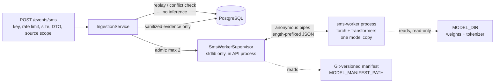

# M4 SMS Inference Worker: Architecture and Integration Contract

Design gate, 6 November 2026, at commit `42da12e`. CI run 42000377582 passed both jobs.

**Status: approved design, not implemented.**
- No worker exists, and inference is not connected to ingestion.
- No schema, API or configuration change has been made.
- The pretrained model has **not** been validated on KAVACH data.

This document is the contract the implementation milestone (M4-I) must satisfy. Decisions are recorded as PRD amendment **D04-A1** and conflict **C-11** ([PRD.md](PRD.md), [MASTER_DEVELOPMENT_PLAN.md](MASTER_DEVELOPMENT_PLAN.md)).

Inputs:
- [M4_PRETRAINED_EVALUATION.md](M4_PRETRAINED_EVALUATION.md): candidate audit and the measured proof of concept on an Apple M1 with 8 GB.
- The proof-of-concept code in `experiments/pretrained/`.
- The current ingestion service, `backend/src/kavach/services/ingestion.py`.

## 1. Decisions

| ID | Decision |
| --- | --- |
| A1 | The pinned Horizon-Labs/phishing-scam-detector-base (revision `fa686fc0…`, weights SHA-256 `1f056ed6…25af`) is permitted for **experimental** SMS fraud classification in the research prototype. |
| A2 | TF-IDF + logistic regression stays the planned comparison baseline (M4.3). Neither model's quality on KAVACH data is claimed before the M4.2 label gate and a logged held-out evaluation. |
| A3 | Inference runs in **one separate worker process** with its own locked environment (PyTorch, Transformers). The FastAPI application and its lockfile never import or install them. |
| A4 | The worker's native outputs (`legitimate`, `spam`, `fraud`) are stored as **uncalibrated model evidence**. They are not `sms_score`, not base risk, not a fusion input and not a tier. `sms_score` stays null until a calibration manifest validated on KAVACH data is approved. |
| A5 | TD-18 controls are mandatory before connection:<br>• at most 2 admitted analyses, one executing and one waiting;<br>• a per-request timeout;<br>• SIGKILL on timeout;<br>• controlled restart with backoff and a circuit breaker. |
| A6 | Saturation and transient worker states are rejected before anything is stored: 429 and 503, retried with the same event ID. Failures of an attempted inference are committed as an explicit `unavailable` stage with a reason. |

## 2. Components



| Component | Location (M4-I) | Dependencies | Responsibility |
| --- | --- | --- | --- |
| Manifest | `deployment/models/sms_classifier.horizon.v1.json` (Git, reviewed) | none | The single trust root: revision, file names, sizes, SHA-256s, labels, limits, self-test expectation, score semantics |
| Supervisor and client | `backend/src/kavach/models/sms_worker.py`, `models/manifest.py` | standard library + pydantic | Spawn, verify readiness, admit, time out, kill, restart, validate output |
| Worker | `workers/sms/` (own `pyproject.toml` and `uv.lock`, package `kavach_sms_worker`) | the `experiments` `pretrained` pins: torch 2.14.1, transformers 5.20.2, tokenizers 0.23.3, safetensors 0.8.0, huggingface-hub 2.2.0, numpy 2.5.4 | Verify artifacts, load once, answer classify frames, nothing else |
| Artifacts | `MODEL_DIR/sms_classifier/<model_key>/<revision>/` (ignored, read-only to the worker) | — | Exactly the manifest's files |

The worker does not import `experiments/`. The manifest is the shared contract, and a cross-project test (root `tests/`) checks that it matches `experiments/pretrained/candidates.py`.

## 3. Model manifest (schema version 1)

```json
{
  "manifest_version": 1,
  "stage": "sms_classifier",
  "model_key": "horizon-phishing-scam-base",
  "repo": "Horizon-Labs/phishing-scam-detector-base",
  "revision": "fa686fc0d6a3634092ada93a7c6b89ab0746b8f8",
  "license": "Apache-2.0; NOTICE retained (mmBERT-base, MIT)",
  "files": [{"name": "model.safetensors", "sha256": "1f056ed6…", "size_bytes": 1230144500}, "… 6 more"],
  "labels": ["legitimate", "spam", "fraud"],
  "max_input_chars": 4096,
  "max_tokens": 256,
  "score_semantics": "uncalibrated_softmax",
  "calibration": null,
  "kavach_validation": "not_validated",
  "runtime": {"python": "3.12", "torch": "2.14.1", "transformers": "5.20.2", "device": "cpu"},
  "self_test": {"canary_id": "canary-v1", "expected_top_label": "fraud",
                "expected_probabilities": [0.0, 0.0, 0.0], "tolerance": 0.001}
}
```

- **Versioning.**
  - Any change to the revision, a file, labels, limits, runtime pins or calibration is a new file with a higher `manifest_version`; files are never edited in place.
  - `model_versions.sms_classifier` stores `"<model_key>@<revision[:12]>+m<manifest_version>:<manifest sha256[:12]>"`, which fits easily in the 4 KiB cap.
  - The expected probabilities are recorded at manifest creation from a real run; the zeros above are placeholders.
- **Allowed files.**
  - Only `.json`, `.safetensors`, `LICENSE` and `NOTICE`.
  - Names must be plain (no directories, no leading dot).
  - Pickle and code suffixes are refused, as in `experiments/pretrained`.
  - A stray file in the artifact directory blocks loading.
- **Calibration.**
  - `calibration` stays `null` in v1.
  - A future manifest may add a fitted calibration with its method, the split version and validation-only fit set, the label-audit reference, and an owner approval reference.
  - Only such a manifest may populate `sms_score` (§7).

## 4. Worker lifecycle

States reported by the supervisor:

| State | Meaning |
| --- | --- |
| `disabled` | `SMS_WORKER_ENABLED=false` (the default) |
| `unverified` | Manifest invalid, artifacts mismatched, or the self-test failed. The model is not loaded. |
| `starting` | Process spawned; verifying hashes, loading, self-testing |
| `ready` | Self-test passed; accepting frames |
| `restarting` | Killed or crashed; waiting out backoff |
| `circuit_open` | 3 timeouts, crashes or invalid outputs within 10 minutes; no restart for 10 minutes, then one probe start |
| `lock_held` | Another API process already owns the worker (§6.3) |

Startup sequence:
1. **Supervisor checks** (in the API process, stdlib only):
   - parse and validate the manifest (pydantic: 40-hex revision, 64-hex hashes, allowed names, labels, limits);
   - acquire the exclusive lock;
   - spawn the worker in the background, so API startup is never blocked.
2. **Worker checks** (before importing torch):
   - rlimit core size 0;
   - offline environment (`HF_HUB_OFFLINE`, `TRANSFORMERS_OFFLINE`, telemetry off);
   - re-verify every file's size and SHA-256 against the manifest the supervisor passed;
   - refuse `auto_map` or a label map different from the manifest.
3. **Model load:**
   - load with `local_files_only=True`, `trust_remote_code=False`, `use_safetensors=True`, `dtype=float32`, CPU only (MPS and CUDA disabled);
   - `torch.set_num_threads(SMS_WORKER_THREADS)`;
   - `model.eval()`.
4. **Self-test:**
   - classify the fictional canary bundled in the worker package;
   - require the expected top label and every probability within `tolerance`;
   - this catches wrong weights, a library numerics change or a broken tokenizer.
5. **Ready:**
   - the worker sends `ready` with the manifest digest and self-test result;
   - the supervisor compares the digest with its own;
   - `SMS_WORKER_START_TIMEOUT_SECONDS` (default 90) bounds steps 2–5. Expiry kills the worker and counts as a failure.

Measured on the proof of concept: load plus hash verification took 9.5 s.

Shutdown: on API shutdown, close stdin and wait 5 s, then SIGKILL. The worker holds no state worth saving.

## 5. Inference protocol (supervisor ↔ worker)

Transport:
- **Channel:** the worker's stdin/stdout, as anonymous pipes created by `subprocess.Popen`. There is no socket, port or file, and no authentication is needed because nothing else can reach the pipes.
- **Process launch:** `close_fds=True`, `start_new_session=True` (the worker gets its own process group for kill).
- **Environment:** an explicit allowlist (`PATH`, `HOME` set to a private directory, `LANG`, the offline variables, `OMP_NUM_THREADS`). The worker never inherits database URLs, HMAC keys, Redis or session secrets.
- **stderr:** read by a supervisor thread that discards content. Only line counts become an operational metric, so a library message can never carry text into logs.
- **Framing:** a 4-byte big-endian length followed by UTF-8 JSON.
  - Request frames are at most 32 KiB; 4,096 characters of SMS text is at most 16 KiB of UTF-8.
  - Response frames are at most 4 KiB.
  - An oversized or unparsable frame is a protocol failure.

Request (one at a time; the worker is strictly serial):

```json
{"v": 1, "type": "classify", "id": "<random 128-bit hex, per call>", "text": "<validated SMS text>"}
```

The `id` is random per call. It is never the event ID, request ID or subscriber, so a worker-side artifact cannot be linked to an event.

Response:

```json
{"v": 1, "type": "result", "id": "…", "status": "ok",
 "probabilities": [0.0123, 0.0210, 0.9667], "truncated": false,
 "duration_ms": 41, "rss_mb": 940}
{"v": 1, "type": "result", "id": "…", "status": "error", "code": "invalid_input" | "internal_error"}
```

Response rules:
- Labels are implied by the manifest order; the worker never sends label names or text.
- The supervisor accepts a result only if all of the following hold:
  - the `id` matches the outstanding request **and** the current worker generation;
  - `probabilities` has exactly the manifest's label count;
  - each probability is finite and in [0, 1], and they sum to 1 ± 0.001.
- Anything else is `invalid_model_output`, and the worker is restarted.
- Responses from a killed generation are unreachable (the pipe is gone) and would be dropped by the generation check anyway. A timed-out worker can never commit a result (API.md requirement).

Control frames: `ready` (worker → supervisor, once) and `ping`/`pong` for an idle liveness check every 30 s. A missed pong counts as a crash.

## 6. TD-18 safety controls

### 6.1 Admission and queueing

- **Admission slots:** `MAX_INFLIGHT_ANALYSES = 2` (D08), a process-wide `threading.BoundedSemaphore`. One slot executes in the worker; the other waits in a FIFO of depth 1. There is no further queue.
- **Acquisition:** non-blocking. With no free slot the request fails immediately with `inference_saturated`.
- **Release:** on every path (result, timeout, crash, invalid output, exception), via `try/finally`, tested.
- **Order:** admission happens **after** the idempotency lookup. Replays and conflicts never consume a slot or reach the worker.
- **Waiting time:** the waiting request's wait counts against its own timeout budget (§6.2).
- **Why one executing slot:**
  - Each worker process holds its own copy of the model (about 0.95 GB measured), so running two would duplicate it.
  - Two threads inside one worker would share fate on a kill.
  - Serial execution at the measured median of 38 ms (p95 48 ms) keeps the queue cost negligible.
- **Future voice stages** share the same two slots: D08 counts analyses, not models.

### 6.2 Timeouts and kill

- **Per-request budget:** `min(SMS_INFERENCE_TIMEOUT_MS (default 2000), remaining ingestion deadline − 2,000 ms commit reserve)`.
- **Deadline already short:** if the budget is below 250 ms at admission, the request is not sent; the stage is `unavailable` with `deadline_exhausted`.
- **On expiry:**
  - SIGKILL the worker's process group, never SIGTERM-and-hope; a thread cannot interrupt a running torch call;
  - the outstanding request becomes `inference_timeout`;
  - a waiting request becomes `worker_restarting`;
  - the supervisor enters `restarting`.
- **Default value:** 2 s is about 40× the measured p95. M4-I must re-measure with `SMS_WORKER_THREADS=2` and record the value it adopts.

### 6.3 Crashes, restart and duplication

- **Crash:** EOF on stdout or a non-zero exit while a request is outstanding means `worker_crashed`.
- **Backoff:** restarts follow 1, 2, 4, 8, 16, 32, 60, 60… seconds, reset after 10 minutes of `ready`.
- **Circuit breaker:** 3 failures (timeout, crash or invalid output) within 10 minutes open the circuit for 10 minutes; it then makes one probe start. Repeatedly poisonous input therefore cannot make the system spin.
- **One worker per deployment:** the supervisor holds an exclusive `fcntl.flock` on `MODEL_DIR/sms_classifier/.supervisor.lock`.
  - A second API process (for example `uvicorn --workers 2`) cannot start a second model copy; it reports `lock_held` instead.
  - The single-process requirement for model-serving deployments is documented in ARCHITECTURE.md.
- **Memory restart:** if the worker reports `rss_mb > SMS_WORKER_MAX_RSS_MB` (default 1536), the supervisor restarts it **between** requests, never mid-request.

### 6.4 Outcome table (no synthetic score, no false-safe result)

| Situation | HTTP | Stored? | `sms_classifier` stage | Receipt warning |
| --- | --- | --- | --- | --- |
| Inference succeeded | 201 | yes | `complete` + model evidence | `SMS_SCORE_UNCALIBRATED` |
| Both slots busy | 429 `CAPACITY_EXCEEDED`, `Retry-After: 1` | **no** | — | — |
| `starting`, `restarting` | 503 `DEPENDENCY_UNAVAILABLE`, `Retry-After` | **no** | — | — |
| Waiting request when the executing one is killed | 503 `DEPENDENCY_UNAVAILABLE` | **no** | — | — |
| `disabled` | 201 | yes | `unavailable`, `model_not_deployed` | `SMS_CLASSIFIER_UNAVAILABLE` |
| `unverified` | 201 | yes | `unavailable`, `model_unverified` | same |
| `circuit_open`, `lock_held` | 201 | yes | `unavailable`, `worker_unavailable` | same |
| Timeout of this request | 201 | yes | `unavailable`, `inference_timeout` | same |
| Worker crashed on this request | 201 | yes | `unavailable`, `worker_crashed` | same |
| Bad output or protocol failure | 201 | yes | `unavailable`, `invalid_model_output` | same |
| Budget below 250 ms | 201 | yes | `unavailable`, `deadline_exhausted` | same |
| Overall deadline passed before commit | 503 `PROCESSING_TIMEOUT` | **no** | — | — |

Why the split (A6):
- **Not stored:** transient capacity states are rejected without storing anything. A same-ID retry gets a fresh analysis, because a stored `unavailable` result is permanent: replays never recompute, as API.md requires.
- **Stored as unavailable:** failures of an attempted inference are committed. Retrying a poisonous message would only repeat the failure, and the circuit breaker bounds that.
- **Never a value:** in every case the scores are null and the tier is `unknown`. Nothing is ever reported as safe or as zero.

## 7. Score semantics and separation from risk

| Term | Meaning | Where it may appear |
| --- | --- | --- |
| **Model evidence** (`model_output.probabilities`) | The model's softmax over `legitimate`/`spam`/`fraud`; uncalibrated; not validated on KAVACH data | `events.signals`, assessment `evidence`, incident detail labeled "uncalibrated research signal" |
| **`sms_score`** | A calibrated score of the KAVACH positive class, per DATASET_GOVERNANCE.md label policy | **null** in manifest v1; only a calibration manifest (§3) may set it |
| **Base / fusion / final score, tier** | Policy outputs (D05, D06) | Computed from `sms_score` only; never from model evidence |

Consequences in M4-I:
- `events.sms_score` stays null.
- The standalone assessment keeps tier `unknown`, a null final score and `analysis_status: partial`, with reason codes `sms_model_uncalibrated` and `no_calibrated_base_signal`.
- `policy_version` becomes `kavach-m4-uncalibrated-sms-evidence`.
- The event's own `analysis_status` is `complete` when the stage completed, so "the model ran" and "risk is known" stay distinguishable.

Correlation (M6) uses subscriber, event-time and structured context eligibility only and never reads model evidence. Fusion reads only `sms_score` and the voice-intent score. A test in M4-I enforces this at the import level: `correlation/` and `policy/` cannot import `models/`, and evidence keys are read through an allowlist.

The UI and API never use the words "probability", "confidence" or "risk" for model evidence. API.md already forbids labeling a score a calibrated probability without supporting model metadata.

## 8. Privacy: the life of the SMS text

1. **Request body.**
   - Read with the existing bound of 32 KiB.
   - Validated into `SMSEvent` (`text` 1–4096 characters) in the API process.
   - Authentication, rate limiting and source scope all run first, and Redis fails closed before the body is read, unchanged.
2. **Idempotency.** The canonical payload is HMAC'd. A replay or conflict returns without the text going anywhere else.
3. **Admission and send.**
   - On admission, the supervisor writes one `classify` frame to the worker's stdin pipe.
   - The text exists in the API process, a kernel pipe buffer and the worker process. Nowhere else: not a file, socket, Redis, PostgreSQL, a log or an exception message.
4. **Inside the worker.**
   - Tokenize, run, reply with numbers only, then drop references to the text, tokens and tensors before reading the next frame.
   - No cache, no batching across requests, no logging, no stderr content.
   - Core dumps are disabled, and `HF_HUB_OFFLINE` means no network use by the libraries.
5. **Back in the API.**
   - The supervisor keeps no reference.
   - `ingest()` persists only allowlisted numbers (§9).
   - The `SMSEvent` object becomes garbage when the request completes. `sender_id` never goes to the worker.
6. **Errors.** Every worker or supervisor failure is reported by a fixed code; the frame, the text and library exception text are never logged.

Limitation: Python cannot guarantee that freed memory is zeroed. The text lives in process memory until it is overwritten, as it does today in the API process. Encrypted swap is the operator's control.

Deferred (TD-27): an OS-level network denial for the worker process (a Linux network namespace or seccomp in the future container). The offline variables plus a socket-guard test are the M4-I control.

## 9. Persisted contract changes (proposed for M4-I; not applied)

`events.signals` moves to `schema_version: 2`, applied only to events written by M4-I code; existing rows stay version 1.

```json
{"schema_version": 2,
 "stages": {"sms_classifier": {
   "status": "complete", "reason": null, "duration_ms": 41,
   "model_output": {"labels": {"legitimate": 0.0123, "spam": 0.021, "fraud": 0.9667},
                    "top_label": "fraud", "score_semantics": "uncalibrated_softmax",
                    "truncated": false}}},
 "reason_codes": ["sms_model_uncalibrated"]}
```

Rules:
- `model_output` exists only when `status` is `complete`.
- Its keys are exactly the manifest labels, with values rounded to 4 decimals.
- No text, tokens, embeddings or attention data is stored.
- The `duration_ms` field holds model time. The supervisor additionally measures admission wait and total stage time as operational metrics; the request's existing `processing_ms` remains the total.

No new column and no migration:
- `sms_score` already exists and stays null.
- The 16 KiB `signals` cap and the 4 KiB `model_versions` cap hold.
- The signal-schema allowlist is enforced at the service boundary, as DATABASE.md already states.

API changes:
- Receipt warning `SMS_SCORE_UNCALIBRATED`.
- 429 `CAPACITY_EXCEEDED` and 503 `DEPENDENCY_UNAVAILABLE` on the ingestion route (both codes already exist in API.md).
- New configuration names (§10).

## 10. Configuration (API.md inventory additions)

| Name | Default | Validation |
| --- | --- | --- |
| `SMS_WORKER_ENABLED` | `false` | When true, all names below are required; in `APP_ENV=pilot` a failure refuses startup, elsewhere it yields `unverified` |
| `SMS_WORKER_PYTHON` | — | Absolute path to the worker environment's interpreter |
| `MODEL_DIR`, `MODEL_MANIFEST_PATH` | — | Existing names; operator-controlled, read-only to the worker |
| `MAX_INFLIGHT_ANALYSES` | 2 | 1–2 while one worker exists |
| `SMS_INFERENCE_TIMEOUT_MS` | 2000 | 100–10000 and below the ingestion deadline minus the reserve |
| `SMS_WORKER_THREADS` | 2 | 1–8 |
| `SMS_WORKER_MAX_RSS_MB` | 1536 | 512–8192 |
| `SMS_WORKER_START_TIMEOUT_SECONDS` | 90 | 10–600 |
| `INFERENCE_DEVICE` | `cpu` | Only `cpu` is accepted in M4-I |

## 11. Memory on an 8 GB Mac

| Consumer | Estimate | Source |
| --- | --- | --- |
| Worker (model + torch + tokenizer) | ~0.95 GB RSS, 0.98 GB peak | Measured in the proof of concept (4 threads; 14 messages) |
| API process | ~0.1–0.2 GB | Estimate; to be measured in M4-I |
| PostgreSQL + Redis (Docker Desktop VM) | VM allocation, typically 2 GB | Operator setting |
| Editor, browser, OS | Rest of the machine | — |

Rules:
- One model copy, enforced by the lock (§6.3).
- CPU only: MPS is off, so unified memory is not used a second time.
- The ONNX files are never loaded.
- `SMS_WORKER_THREADS=2` leaves cores for the API and database.
- Do not run `python -m pretrained run` while the worker is up.
- The RSS ceiling restarts a bloated worker.

The M4-I acceptance run (§12, P1) must show no sustained swap growth on the 8 GB machine.

## 12. Acceptance criteria and tests for M4-I

The default suites use a stdlib **fake worker**: a test-only script in `backend/tests/` that speaks the protocol with scripted behaviors (ok, sleep, exit, garbage, oversize, wrong id, stderr spam). It is never packaged or shipped. Real-model checks are opt-in (`-m model`) and run locally.

| # | Test | Pass condition |
| --- | --- | --- |
| C1 | 3 simultaneous submissions, slow fake | 2 admitted, 1 gets 429 `CAPACITY_EXCEEDED`, nothing stored for it; a same-ID retry later gets 201 |
| C2 | Slot release | After each of ok/timeout/crash/invalid/exception, both slots are free (semaphore value 2) |
| C3 | Replay and conflict | Worker call count 0 for a replay (200, original result) and for a 409 conflict; a replay of an `unavailable` event stays `unavailable` after the worker becomes ready |
| C4 | Concurrent first submissions of one event ID | At most 2 inferences, exactly one row, both responses agree |
| T1 | Timeout | The fake sleeps past the budget; its PID is gone (SIGKILL), the stage is `inference_timeout` and committed; the waiting request gets 503; no late result is applied (generation check) |
| T2 | Deadline arithmetic | A remaining deadline below budget + reserve gives `deadline_exhausted` without a frame being sent; the overall deadline still yields 503 `PROCESSING_TIMEOUT` with nothing stored |
| K1 | Crash mid-request | `worker_crashed` committed; restart after backoff; 3 failures in 10 minutes give `circuit_open`, then events are committed `worker_unavailable` |
| K2 | Invalid output | Wrong count, NaN, negative, sum ≠ 1, wrong id, oversize frame and non-JSON each give `invalid_model_output` and a restart |
| A1 | Invalid artifacts | Missing file, hash or size mismatch, stray `.bin`/`.py`/`.pkl`, `auto_map`, label-map mismatch, non-40-hex revision, edited manifest and self-test mismatch each give `unverified`; the fake asserts the model was never "loaded" |
| A2 | Lock | A second supervisor gets `lock_held`; one worker process exists |
| P1 | Privacy | After a mixed run, scan every PostgreSQL table, Redis keys/values, captured logs (API + worker stderr), receipts and error bodies: no SMS text, no `sender_id`; the worker environment holds no allowlist-violating variable; the frame `id` differs from the event ID |
| P2 | Fail-closed order | Redis down gives 503 before any frame; rate-limited gives 429 before any frame; wrong source gives 403 before any frame |
| S1 | Semantics | `sms_score` null, tier `unknown`, assessment `partial` with `sms_model_uncalibrated`, `SMS_SCORE_UNCALIBRATED` warning, `model_versions` string format; schema-v2 allowlist rejects extra keys |
| S2 | Isolation | `backend/uv.lock` has no torch/transformers/tokenizers; `import kavach` imports none of them; `correlation`/`policy` do not import `models` |
| S3 | Manifest parity | The Git manifest equals the pinned record in `experiments/pretrained/candidates.py` (root cross-project test) |
| M1 | Real model, opt-in, local | Ready within 90 s; self-test passes; 200 sequential fictional messages: p95 recorded with 2 threads, max RSS ≤ 1536 MB, no swap growth on 8 GB M1; worker run under a network-denying sandbox |
| M2 | Real kill, opt-in | A real inference killed mid-run is gone within 1 s, and the restarted worker passes the self-test |

Plus the existing backend default suite (267) and integration suite (319) unchanged and passing, Ruff, both lockfile checks, `alembic check` with no differences, and both CI jobs green.

## 13. Unresolved before or during M4-I

| ID | Item | Owner |
| --- | --- | --- |
| U1 | The fraud/spam mapping to the KAVACH positive class and any calibration: needs the M4.2 label gate, an adopted split and validation-only fitting | Owner, after M4.2 |
| U2 | `SMS_INFERENCE_TIMEOUT_MS` and `SMS_WORKER_THREADS` final values: re-measure (M1) | M4-I |
| U3 | Container packaging of the worker environment (D10, M11) | Deployment milestone |
| U4 | OS-level network denial for the worker (TD-27) | M11 |
| U5 | Whether incident detail shows model evidence to viewers or analysts only | Owner (M7a/M8) |
| U6 | Self-reported limits of the model (about 11% false positives on genuine notifications, a missed call-me disconnection scam in the proof of concept) remain unmeasured on KAVACH data | M4.3 evaluation |
